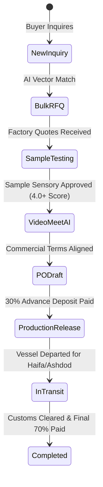

# FoodXchange — Admin Operations Guide & Deal Desk Playbook

> **Standard Operating Procedures (SOPs) for the FoodXchange Deal Desk**  
> *Last updated: October 21, 2026*

---

## 1. Access & Admin Authentication

The admin console is hosted at `/admin` (production: `https://fdx.trading/admin`).

- **Authentication Method**: Passwordless magic link or master password verification.
- **Session Security**: HMAC-SHA256 encrypted session cookie (`admin_session`) valid for 8 hours.
- **Admin Configuration**: Netlify environment variable `ADMIN_EMAILS` lists authorized emails.

---

## 2. Managing the 6 Deal Lifecycle Stages

### Stage 1: Reviewing Inquiries & Running Matches
1. Open `/admin` or `/admin/pipeline`.
2. New inquiries arrive from `/en/contact` or `/en/sourcing` with an AI-generated Product Intent Profile (PIP).
3. If no catalog match exists, run the catalog spider at `/admin/scraper` to ingest candidate European factories.

### Stage 2: Bulk RFQ Outreach
1. On `/admin/pipeline`, click the **"⚡ Bulk RFQ"** button.
2. Select target suppliers from the matched candidates.
3. Review target CIF Haifa/Ashdod benchmark price, requested container volumes, and packaging specifications.
4. Click **"Dispatch Bulk RFQs"** — automated outreach emails are sent to supplier export managers via Resend, and records are tracked under `supplier_actions`.

### Stage 3: Physical Tasting Samples & Sensory Evaluation
1. In the deal pipeline table, click the **"📦 Sample Hub"** action.
2. Manage the 4-phase sample tracking workflow:
   - **Commercial Pre-Alignment**: Verify MOQ and CIF estimates before factory bears courier expense.
   - **DHL/FedEx Dispatch**: Enter courier Air Waybill (AWB) number and consignee address in Israel.
   - **Israel Customs Clearance**: Track sample release via Ministry of Agriculture & Health fast-track import.
   - **5-Dimension Tasting Scorecard**: Score sample from 1 to 5 on:
     - Taste & Flavor Profile
     - Texture & Mouthfeel
     - Retail Packaging & Hebrew Label Suitability
     - Shelf Life & Preservatives
     - Commercial Price-to-Quality Fit
3. Approving a sample automatically qualifies the deal for Stage 4.

### Stage 4: Scheduling Video Calls & Running the AI Summarizer
1. In the pipeline table, click the **`[ 🎥 Meet / AI ]`** action.
2. **Scheduling a Google Meet Call**:
   - The modal automatically provisions a Google Meet room (`https://meet.google.com/fdx-...`).
   - The dual-timezone calculator shows call times in both **Israel Time (Asia/Jerusalem)** and **Europe Time (Europe/Rome/Paris)** to prevent scheduling mistakes.
   - Click **"Schedule & Send Calendar Invite"** to generate 1-click Google Calendar web invite links and post meeting cards into the deal message history.
3. **AI Call Intelligence Summarizer**:
   - Switch to the **"🤖 AI Call Summarizer"** tab.
   - Paste raw call notes, voice memos, or video transcripts (or click *"Load Sample Call Notes"* for 1-click testing).
   - Click **"Run AI Sourcing Intelligence"**.
   - Gemini / Claude automatically extracts commercial CIF terms, payment splits, sample commitments, kosher audit dates, and action items with owners (`Buyer`, `Supplier`, or `FDX Desk`).
   - Checking *"Advance deal pipeline stage upon saving"* will automatically transition the deal stage.

### Stage 5: B2B Purchase Order Generation
1. In the pipeline table, click **"📝 Generate PO"**.
2. Set container volume (e.g., 1 x 40ft High Cube FCL), unit prices, and delivery terms (Incoterms 2020: CIF Haifa or FOB Genoa/Valencia).
3. Select payment milestones:
   - **Standard**: 30% advance on PO confirmation / 70% against Bill of Lading copy & pre-shipment lab certificate.
4. Export the bilingual Hebrew/English PO PDF for buyer and factory countersignature.

### Stage 5.5: Hebrew Packaging & Regulatory AI Audit (`/admin/compliance/label-checker`)
Before releasing a factory production run, audit packaging artwork against Israeli Standard SI 1145 and Red Warning Badge regulations:
1. In the pipeline table, click the **`[ 🏷️ Label ]`** action on the deal row, or visit `/admin/compliance/label-checker`.
2. Select a reference preset or input custom Hebrew denominations, ingredients, importer details, and nutritional values.
3. The engine automatically checks:
   - Mandatory Front-of-Package Red Badges (Sodium &ge;400mg, Sugar &ge;10g, Sat Fat &ge;4g per 100g).
   - Ingredients descending order and percentage declarations.
   - Chief Rabbinate of Israel import division kosher clause (אישור הרה״ר).
   - Allergen information bold box.
4. Click **"Copy Designer Notes"** to provide the European factory designer with numbered, actionable corrections before printing plates are engraved.
5. Saving the audit logs the compliance breakdown to `sourcing_matches.match_breakdown.label_compliance` and posts an audit notification to the deal message thread.

### Stage 6: Production Release & Vessel Tracking
1. Once advance deposit receipt is confirmed, click **"🚀 Release Production"**.
2. Sign off on:
   - Final Hebrew label plate proofs.
   - Chief Rabbinate kosher supervisor production schedule.
   - Laboratory Certificate of Analysis (COA).
3. Log ocean vessel booking reference, shipping line (e.g. ZIM, MSC, Maersk), container number, and estimated arrival date (ETA) at Haifa or Ashdod port.

---

## 3. Knowledge Base & System SOP Management (`/admin/docs`)

FoodXchange contains an integrated operating manual with 54 technical specifications, regulatory guides, and matching algorithms:

- **Admin URL**: `/admin/docs`
- **Audience Filtering**:
  - **🔒 Internal SOPs**: Deal facilitation playbooks, margin structures, supplier negotiation templates, and algorithmic scoring specifications.
  - **🌐 Public Guides**: Customer-facing explainers on Israeli food import laws, kosher supervision categories, and private-label timelines (synced with `/en/help`).
- **Israel Import Guide CMS**: Direct access to `/admin/import-guide` with 43 category-specific import guides.

---

## 4. Supplier Product Scraper (`/admin/scraper`)

Bulk-imports European manufacturer catalogs using **Firecrawl v2**:

1. Navigate to `/admin/scraper`.
2. Input the supplier website URL (e.g., `https://example-pasta.it`).
3. Firecrawl maps product URLs, renders dynamic single-page applications, and extracts markdown specs.
4. Claude normalizes product names, package formats, and brix into `supplier_products`.
5. Embeddings are generated with Voyage AI (`voyage-3`) for real-time vector matching.

---

## 5. Portal Impersonation & Diagnostics

Admins can impersonate any buyer or supplier to troubleshoot portal UX:

1. Locate the buyer or supplier in the dashboard.
2. Click **"View as Buyer"** or **"View as Supplier"**.
3. A signed HMAC impersonation cookie (`IMPERSONATION_SECRET`) is generated.
4. An orange banner appears: *"Impersonating [Name] — Click End Session to Exit"*.

---

## 6. Digital Business Card & Inbound Ingestion Suite

The FoodXchange e-Business Card (`/business-card/[handle]`, production: `https://fdx.trading/business-card/udi`) acts as the high-conversion mobile front door for European factories and Israeli retail buyers:

- **Dedicated Hebrew Edition (`?lang=he`) & Browser Locale Detection**: 
  - Direct URL access to `https://fdx.trading/business-card/udi?lang=he` renders the card in full Hebrew with RTL layout and localized OpenGraph metadata for WhatsApp share previews in Israel.
  - Automatic locale detection detects Israeli browsers (`navigator.language.startsWith('he')`) and switches to Hebrew automatically when no language override is present.
  - Interactive top switcher (`[ EN | עב ]`) allows instant toggle while synchronizing browser URL query parameters without reloading.
- **Dynamic Localized vCard 3.0 (`/api/vcard/[handle]`)**: 
  - In default/English mode, exports `Udi-Stryk.vcf` with global title, company, and email.
  - In Hebrew mode (`?lang=he`), exports `Udi-Stryk-FoodXchange-Hebrew.vcf` with full Hebrew name ("אודי סטריק"), title ("מייסד ומנהל"), company ("FoodXchange (פודאקסצ'יינג')"), and Israeli retail sourcing notes.
- **⚡ Instant Sourcing Inquiry Drawer (`/api/card/inquiry`)**: Allows buyers to submit an RFQ in under 30 seconds with 1-click active sourcing suggestions (e.g. Extra Virgin Olive Oil 750ml, Frozen Potato Wedges, Organic Granola), target volume, and Kosher requirements. Ingests directly into `sourcing_requests` with automated email and in-app admin alert.
- **📅 Direct 15-Minute Intro Call Scheduler (`/api/card/meeting-schedule`)**: Provides an interactive calendar strip for the next 8 business days (Sunday–Thursday, Israel Time IDT / Europe Time CET). Provisions permanent Google Meet rooms, generates 1-click Google Calendar links, and outputs `.ics` calendar files.
- **🖨️ Printable High-Res Vector QR Code Studio (`/admin/card-editor`)**: Located inside the Admin Card Editor. Features Error Correction Level **H** (30% recovery) with an embedded FoodXchange Orange `#F47920` 'X' emblem, 4 brand color palettes, 1-click toggle between **Global / English** expo codes and **Israel / Hebrew** retail codes with custom Hebrew print caption, and 1-click 1200x1200px PNG and scalable SVG vector downloads.
- **📊 6-Metric Conversion Funnel Analytics (`/admin/card-analytics`)**: Tracks page views, vCard saves, WhatsApp clicks, RFQ inquiries, scheduled calls, and overall conversion rate percentage with live 30-event audit stream.

---

### Hebrew Retail Buyer Portal & Global Bilingual Switcher (`/he`)

A dedicated commercial entry point for Israeli supermarket category managers (Shufersal, Victory, Rami Levy, Yohananof, Osher Ad) and food importers:

- **Canonical URL**: `https://fdx.trading/he`
- **RTL Typography & Layout**: Built with native RTL text direction (`dir="rtl"`) and responsive Tailwind layout.
- **Commercial Focus**:
  - 🏷️ **Private Label (מותג פרטי)**: Highlighting custom packaging and Hebrew labeling compliance (ת״י 1145).
  - ✡️ **Kosher Pathways**: Clarifying kosher feasibility pathways (Chief Rabbinate and recognized Badatz bodies).
  - 🚢 **Factory-Direct CIF Pricing**: Clear economics on container-level procurement (FCL) from 600+ European factories.
  - ⚡ **Streamlined RFQ Submission**: Direct links to Hebrew sourcing requests, direct WhatsApp routing with founder Udi Stryk, and 15-minute video intro booking.
- **Global Header Bilingual Toggle (`[ EN | עב ]`)**:
  - Integrated into [`components/Header.tsx`](file:///c:/Users/UdiFDX/Desktop/WebSites/FDX.TRADING/components/Header.tsx) across desktop and mobile headers.
  - Automatically maps mirror routes (`/` ↔ `/he`, `/en/contact` ↔ `/he/contact`, `/en/blog` ↔ `/he/blog`, `/en/newsletter` ↔ `/he/newsletter`).
  - Automatically switches navigation labels to Hebrew when browsing `/he/*`.
- **Localized RTL Footer**: [`components/ui/Footer.tsx`](file:///c:/Users/UdiFDX/Desktop/WebSites/FDX.TRADING/components/ui/Footer.tsx) accepts `lang="he"`, serving Hebrew navigation, Israeli corporate details, and founder contact `udi@fdx.trading`.

---

## 7. Unified B2B Meetings & Video Calls Command Center (`/admin/meetings`)

A centralized operations desk for all commercial video interactions across the deal lifecycle:

- **Unified Chronological Stream**: Integrates both 15-minute digital card intro calls and Stage 4 commercial sourcing alignment calls from active matches.
- **Dual Timezone Clocks**: Displays Israeli Time (IDT) and Central European Time (CET) side-by-side to eliminate scheduling errors with factories across Italy, Spain, France, and Greece.
- **Live Status Badges**: Real-time visual pills (`🔴 LIVE NOW`, `In 15 mins`, `Today in 2h`, `Tomorrow`, `Completed`).
- **1-Click Operational Controls**:
  - 📹 **Join Google Meet**: Direct launch into the video room.
  - 📅 **Open Google Calendar**: Web calendar link.
  - 💬 **Ping WhatsApp**: Generates pre-formatted WhatsApp reminder to the attendee with the Google Meet link.
  - 🧠 **AI Intelligence Brief**: Directly opens the AI Meeting Intelligence modal to ingest call transcripts/notes, generate structured Hebrew commercial summaries, extract CIF terms, and assign sample dispatch tasks.
  - **+ Schedule Video Call**: Quick-modal to create an ad-hoc video meeting and calendar invitation in 10 seconds.

---

## 8. B2B Assortment Deck & Factory Showcase Generator (`/admin/deck-builder`)

The Assortment Deck Studio allows the deal desk to create multi-factory presentation decks for Israeli supermarket category managers (Shufersal, Victory, Yohananof, Osher Ad, Rami Levy):

- **Deck Studio URL**: `/admin/deck-builder`
- **One-Click Category Presets**: Instant loading of curated European factory selections:
  - 🫒 *Extra Virgin Olive Oil (Spain & Italy)*
  - 🥫 *Canned Tuna & Pelagic Fish Fillets (Spain & Portugal)*
  - 🍟 *Frozen French Fries & Potato Wedges (Belgium)*
- **Dual Presentation Formats & Full Hebrew RTL Support**:
  1. **Print & Save Vector PDF (`/api/deck/[token]/pdf` and `?lang=he`)**: An A4 Landscape executive presentation containing cover slide, commercial comparison matrix table, factory deep-dive slides (certifications BRC/IFS, Kosher pathway, CIF Haifa economics), and Udi Stryk QR contact back-cover. Automatically renders native Hebrew typography and RTL layout when `?lang=he` is requested.
  2. **Interactive Secret Web Deck (`/deck/[token]` and `?lang=he`)**: Mobile & desktop responsive presentation for retail buyers with on-screen `[ EN | עב ]` toggle and direct CTAs:
     - 📦 **Request Tasting Sample Kit (הזמנת ערכת דוגמאות לטעימה)**: Dispatches courier sample order directly to Israeli office or test kitchen.
     - 📅 **Book 15-Min Sourcing Review (תיאום שיחת וידאו עם אודי)**: Direct Google Meet scheduling with Hebrew or English calendar modal.
     - 💬 **WhatsApp Udi (שיחה בווטסאפ)**: Pre-formatted WhatsApp context message in the chosen language.
     - 📥 **Download PDF (הורדת מצגת PDF)**: Instant access to the vector PDF deck in English or Hebrew.
- **Admin Deal Desk Sharing Controls**:
  - The Assortment Deck generation modal provides 1-click links to copy the English link or the Hebrew link (`?lang=he`).
  - 1-click WhatsApp buttons for dispatching English or Hebrew pre-formatted outreach to retail category managers (Shufersal, Victory, Yohananof, Osher Ad, Rami Levy).
- **Real-Time Telemetry**: Every deck view and button click is tracked in `proposal_views` to alert the deal desk the moment a category manager reviews the deck.

---

## 9. Interactive Hebrew Sourcing RFQ & Benchmark Upload (`/he/buyers` & `/he/sourcing`)

The Hebrew Sourcing RFQ & Benchmark Upload engine powers two dedicated Hebrew portals for Israeli supermarket category managers and food importers:

- **Hebrew Buyers Portal**: `https://fdx.trading/he/buyers`
- **Dedicated Hebrew Sourcing Form**: `https://fdx.trading/he/sourcing`
- **RTL Sourcing Request Form (`SourcingRequestForm.tsx`)**:
  - `lang="he"` prop support across all four steps.
  - **Step 1: Benchmark Photo Upload (`MultiImageUpload.tsx`)**: Multi-image drag & drop or camera capture for up to 5 photos with Hebrew labels (`חזית האריזה`, `תווית רכיבים`, `ברקוד / יצרן`).
  - **Step 2: Hebrew Voice Recognition & Real-Time AI Concierge**: Web Speech API integration defaulted to Hebrew (`voiceLang="he-IL"`), live transcript feedback, Hebrew prompt examples (Mayo 5kg, EVOO, canned tuna, frozen fries), and benchmark brand chips (הלמנס, היינץ, מוטי, ברילה, בלקוני, אסם, ריו מרה).
  - **Step 3: 1-Click Hebrew Retail & Regulatory Presets**:
    - Branding mode: `🏷️ מותג פרטי (PL)`, `🏭 מותג יצרן`, `🤝 שניהם אפשריים`.
    - Packaging & dispenser: דלי 5 ק״ג + משאבה, בקבוק לחיץ, צנצנת זכוכית, שקיקים אישיים.
    - Dietary & health claims: ללא גלוטן, טבעוני / ללא לקטוז, ללא תוספת סוכר, אורגני, ללא חומרים משמרים, Non-GMO.
    - Kosher options: רבנות ראשית (מהדרין), בד״ץ (העדה החרדית / חתם סופר), רבנות רגילה (יבוא), כל כשרות מוכרת, ללא דרישת כשרות.
    - Volume units: מכולות בשנה (Containers), משטחים בשנה (Pallets), טונות בשנה (Tons), ק״ג בשנה (Kg), יחידות בשנה (Units).
  - **Step 4: Hebrew Buyer Contact Details (`ContactFields.tsx`)**: Defaults to Israel (+972) with phone/WhatsApp formatting and optional company field.
- **Backend Ingestion**:
  - Automatically posts to `/api/sourcing/submit` with `source: "buyers-he"` or `source: "sourcing-page-he"`.
  - Automatically creates a buyer inquiry and launches AI Concierge analysis.
  - Appears in `/admin/requests` and `/admin/pipeline` with full Hebrew requirement context and translated English brief.
- **Global Bilingual Navigation Switcher (`[ EN | עב ]`)**:
  - Integrated into `components/Header.tsx` with mirror paths `/en/buyers` ↔ `/he/buyers` and `/en/sourcing` ↔ `/he/sourcing`.

---

## 10. Hebrew Import Guide & Israeli Food Regulation Hub (`/he/import-guide`)

The Hebrew Food Import Guide & Regulatory Hub provides Israeli supermarket category managers, food distributors, and private-label brand owners with an authoritative, native Hebrew knowledge center for navigating Israeli food import standards:

- **Hub URL**: `https://fdx.trading/he/import-guide`
- **Category Filter Hub**: `https://fdx.trading/he/import-guide/category/[category]`
- **Article Reader & Buyer Executive Brief**: `https://fdx.trading/he/import-guide/[slug]`

### Key Architecture & Features:
1. **Four Core Israeli Regulatory Pillars**:
   - 🇪🇺 **רפורמת היבוא האירופאי ("מה שטוב לאירופה טוב לישראל")**: Clear breakdown of adoption of Regulation (EC) 178/2002, Green Channel fast-tracking, and exemption from pre-import approvals for compliant European packaged food.
   - 🏷️ **ת״י 1145 וסימון אזהרות אדומות**: Step-by-step compliance for Hebrew labeling, allergen declarations, nutritional values per 100g, and front-of-package red warning stickers (נתרן, סוכר, שומן רווי).
   - ✡️ **כשרות רבנות ראשית ובד״צים מוכרים**: Full vetting pathway for Orthodox Rabbinate import approvals, Mehadrin certifications (בד״ץ העדה החרדית, לנדא, חתם סופר), mashgiach factory visits, and non-kosher risk mitigation.
   - 🚢 **שחרור מהיר בנמל אשדוד וחיפה (מכס ולוגיסטיקה)**: Demurrage prevention, Certificate of Origin (EUR.1 / Invoice Declaration), Free Sale Certificates (CFS), and cold-chain customs clearance.
2. **Comprehensive Category Coverage (All 9 Regulatory Tracks in Hebrew)**:
   - מדריכי עשה-ואל-תעשה (How-To Guides)
   - רפורמת היבוא ותקינה ישראלית (European Reform & Standards)
   - סימון מזון ות״י 1145 (Food Labeling & Mandatory Stickers)
   - כשרות ושחיטה בחו״ל (Kosher Certification)
   - בטיחות מזון ותקני BRC/IFS (Food Safety Standards)
   - מכס, הובלה ושרשרת אספקה (Customs & Cold-Chain Logistics)
   - ניהול סיכונים ובדיקות מעבדה (Risk Management & Lab Testing)
   - תביעות בריאות ומזון רגיש (Dietary & Health Claims)
   - עדכוני חקיקה ומשרד הבריאות (Regulatory Alerts & Circulars)
3. **Israeli Buyer Executive Brief (תקציר מנהלים לקניין ישראלי)**:
   - Present on every individual article page at `/he/import-guide/[slug]`.
   - Offers an immediate 4-point takeaway: practical retail impact, required factory paperwork, kosher feasibility, and tariff/customs classification.
   - Includes a 1-click toggle to view the original full English research article.
4. **Interactive Buyer FAQ & Conversion Funnel**:
   - Native Hebrew interactive accordion answering the most pressing buyer questions regarding timeline, sample validation, and lab verification.
   - Sticky conversion banner linking directly to `/he/sourcing` and pre-configured WhatsApp consultation with Udi Stryk.
5. **Bidirectional Navigation**:
   - Synchronized header language toggle (`[ EN | עב ]`) dynamically translating `/en/import-guide` ↔ `/he/import-guide` across all deep category and article routes.

---

## 11. Hebrew Landed Cost & Retail Margin Calculator (`/he/calculator`)

The Landed Cost & Gross Margin Simulator allows Israeli supermarket category managers, commercial food importers, and private-label buyers to convert European factory quotations into landed cost at Israeli distribution centers, evaluate retail gross margins, and calculate benchmark brand savings:

- **Hebrew Calculator URL**: `https://fdx.trading/he/calculator`
- **English Calculator URL**: `https://fdx.trading/en/calculator`

### Key Architecture & Features:
1. **1-Click European Food Retail Presets**:
   - 🫒 **Extra Virgin Olive Oil 750ml (Spain/Italy)**: €3.85 CIF, 21,000 bottles (40ft Dry), Target Shelf ₪29.90 (vs ₪39.90 Filippo Berio).
   - 🥫 **Canned Light Tuna 4-Pack 4x160g (Spain)**: €2.15 FOB, 36,000 packs (40ft Dry), Target Shelf ₪18.90 (vs ₪26.90 Rio Mare).
   - 🍟 **Premium Belgian Frozen Fries 2.5kg (Belgium)**: €1.45 EXW, 8,200 bags (40ft Reefer), Target Shelf ₪16.90 (vs ₪24.90 Lutosa).
   - 🍝 **Premium Italian Durum Pasta 500g (Italy)**: €0.52 FOB, 44,000 packs (40ft Dry), Target Shelf ₪5.90 (vs ₪8.90 Barilla).
   - 🍅 **Finely Chopped Italian Tomatoes 400g (Italy)**: €0.44 CIF, 48,000 cans (20ft Dry), Target Shelf ₪4.50 (vs ₪6.90 Mutti).

2. **Full Incoterm & Landed Cost Arithmetic Engine**:
   - Multi-currency support (EUR, USD, GBP, ILS) with live-adjustable FX rates.
   - Incoterms: EXW, FOB, CIF, DDP.
   - International logistics: European inland haulage, ocean freight per container type (20ft Dry, 40ft HC, 40ft Reefer), and marine cargo insurance (0.3%).
   - Israeli ports & clearance: Ashdod / Haifa port charges, customs brokerage, delivery order, Ministry of Health quarantine station, and Standards Institute lab testing.
   - 0% customs duty default under EU-Israel Free Trade Agreement (EUR.1 origin).

3. **Dual Retail Shelf Pricing Modes**:
   - **Mode A (Target Consumer Shelf Price)**: Input target shelf price (incl. VAT) -> Computes retailer gross margin % and profit per unit.
   - **Mode B (Target Gross Margin %)**: Input desired retailer gross margin (e.g. 35%) -> Computes required consumer shelf price (incl. VAT).
   - Adjustable retail VAT rate (default 18%).

4. **Benchmark Brand Comparison & Annualized Chain Economics**:
   - Immediate calculation of consumer savings per unit and percentage reduction vs leading shelf brands.
   - Annual container volume slider (1–24 FCLs) showing total annual extra gross profit generated for the retail supermarket chain.

5. **Integrated Conversion & Sharing CTAs**:
   - 💬 **WhatsApp Sharing**: Generates pre-formatted Hebrew commercial brief to category managers and commercial leadership.
   - 📋 **Executive Summary Copy**: Formatted clipboard summary for retail assortment meetings.
   - 🚀 **1-Click Factory RFQ**: Directly launches `/he/sourcing` with pre-filled product name, volume, and target pricing parameters.
   - 🖨️ **Print / Vector PDF**: Print-ready A4 stylesheet.
   - 🌐 **Header & Footer Synchronization**: Synchronized language toggle (`[ EN | עב ]`) with mirror path switching.
