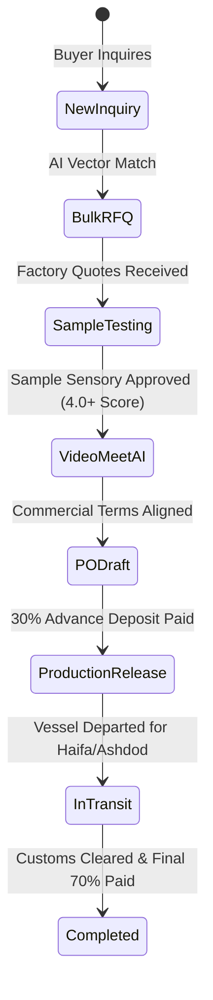

# FoodXchange — Admin Operations Guide & Deal Desk Playbook

> **Standard Operating Procedures (SOPs) for the FoodXchange Deal Desk**  
> *Last updated: October 21, 2026*

---

## 1. Access & Admin Authentication

The admin console is hosted at `/admin` (production: `https://fdx.trading/admin`).

- **Authentication Method**: Passwordless magic link or master password verification.
- **Session Security**: HMAC-SHA256 encrypted session cookie (`admin_session`) valid for 8 hours.
- **Admin Configuration**: Netlify environment variable `ADMIN_EMAILS` lists authorized emails.

---

## 2. Managing the 6 Deal Lifecycle Stages

### Stage 1: Reviewing Inquiries & Running Matches
1. Open `/admin` or `/admin/pipeline`.
2. New inquiries arrive from `/en/contact` or `/en/sourcing` with an AI-generated Product Intent Profile (PIP).
3. If no catalog match exists, run the catalog spider at `/admin/scraper` to ingest candidate European factories.

### Stage 2: Bulk RFQ Outreach
1. On `/admin/pipeline`, click the **"⚡ Bulk RFQ"** button.
2. Select target suppliers from the matched candidates.
3. Review target CIF Haifa/Ashdod benchmark price, requested container volumes, and packaging specifications.
4. Click **"Dispatch Bulk RFQs"** — automated outreach emails are sent to supplier export managers via Resend, and records are tracked under `supplier_actions`.

### Stage 3: Physical Tasting Samples & Sensory Evaluation
1. In the deal pipeline table, click the **"📦 Sample Hub"** action.
2. Manage the 4-phase sample tracking workflow:
   - **Commercial Pre-Alignment**: Verify MOQ and CIF estimates before factory bears courier expense.
   - **DHL/FedEx Dispatch**: Enter courier Air Waybill (AWB) number and consignee address in Israel.
   - **Israel Customs Clearance**: Track sample release via Ministry of Agriculture & Health fast-track import.
   - **5-Dimension Tasting Scorecard**: Score sample from 1 to 5 on:
     - Taste & Flavor Profile
     - Texture & Mouthfeel
     - Retail Packaging & Hebrew Label Suitability
     - Shelf Life & Preservatives
     - Commercial Price-to-Quality Fit
3. Approving a sample automatically qualifies the deal for Stage 4.

### Stage 4: Scheduling Video Calls & Running the AI Summarizer
1. In the pipeline table, click the **`[ 🎥 Meet / AI ]`** action.
2. **Scheduling a Google Meet Call**:
   - The modal automatically provisions a Google Meet room (`https://meet.google.com/fdx-...`).
   - The dual-timezone calculator shows call times in both **Israel Time (Asia/Jerusalem)** and **Europe Time (Europe/Rome/Paris)** to prevent scheduling mistakes.
   - Click **"Schedule & Send Calendar Invite"** to generate 1-click Google Calendar web invite links and post meeting cards into the deal message history.
3. **AI Call Intelligence Summarizer**:
   - Switch to the **"🤖 AI Call Summarizer"** tab.
   - Paste raw call notes, voice memos, or video transcripts (or click *"Load Sample Call Notes"* for 1-click testing).
   - Click **"Run AI Sourcing Intelligence"**.
   - Gemini / Claude automatically extracts commercial CIF terms, payment splits, sample commitments, kosher audit dates, and action items with owners (`Buyer`, `Supplier`, or `FDX Desk`).
   - Checking *"Advance deal pipeline stage upon saving"* will automatically transition the deal stage.

### Stage 5: B2B Purchase Order Generation
1. In the pipeline table, click **"📝 Generate PO"**.
2. Set container volume (e.g., 1 x 40ft High Cube FCL), unit prices, and delivery terms (Incoterms 2020: CIF Haifa or FOB Genoa/Valencia).
3. Select payment milestones:
   - **Standard**: 30% advance on PO confirmation / 70% against Bill of Lading copy & pre-shipment lab certificate.
4. Export the bilingual Hebrew/English PO PDF for buyer and factory countersignature.

### Stage 6: Production Release & Vessel Tracking
1. Once advance deposit receipt is confirmed, click **"🚀 Release Production"**.
2. Sign off on:
   - Final Hebrew label plate proofs.
   - Chief Rabbinate kosher supervisor production schedule.
   - Laboratory Certificate of Analysis (COA).
3. Log ocean vessel booking reference, shipping line (e.g. ZIM, MSC, Maersk), container number, and estimated arrival date (ETA) at Haifa or Ashdod port.

---

## 3. Knowledge Base & System SOP Management (`/admin/docs`)

FoodXchange contains an integrated operating manual with 54 technical specifications, regulatory guides, and matching algorithms:

- **Admin URL**: `/admin/docs`
- **Audience Filtering**:
  - **🔒 Internal SOPs**: Deal facilitation playbooks, margin structures, supplier negotiation templates, and algorithmic scoring specifications.
  - **🌐 Public Guides**: Customer-facing explainers on Israeli food import laws, kosher supervision categories, and private-label timelines (synced with `/en/help`).
- **Israel Import Guide CMS**: Direct access to `/admin/import-guide` with 43 category-specific import guides.

---

## 4. Supplier Product Scraper (`/admin/scraper`)

Bulk-imports European manufacturer catalogs using **Firecrawl v2**:

1. Navigate to `/admin/scraper`.
2. Input the supplier website URL (e.g., `https://example-pasta.it`).
3. Firecrawl maps product URLs, renders dynamic single-page applications, and extracts markdown specs.
4. Claude normalizes product names, package formats, and brix into `supplier_products`.
5. Embeddings are generated with Voyage AI (`voyage-3`) for real-time vector matching.

---

## 5. Portal Impersonation & Diagnostics

Admins can impersonate any buyer or supplier to troubleshoot portal UX:

1. Locate the buyer or supplier in the dashboard.
2. Click **"View as Buyer"** or **"View as Supplier"**.
3. A signed HMAC impersonation cookie (`IMPERSONATION_SECRET`) is generated.
4. An orange banner appears: *"Impersonating [Name] — Click End Session to Exit"*.
