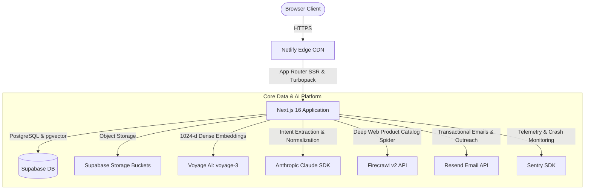
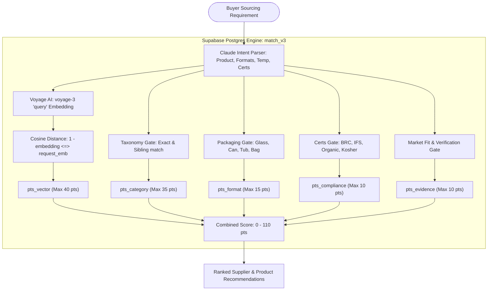
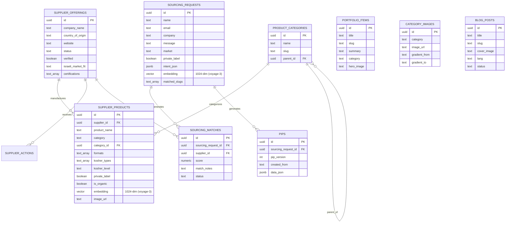

# FoodXchange — System Architecture & Data Model

## 1. Cloud Architecture

---

## 2. The Matching Process & AI Architecture (`match_v3`)

The FoodXchange matching engine pairs real-time buyer sourcing inquiries with active European manufacturer catalogs using a hybrid of **semantic vector search** and **hard regulatory trade constraints**.

### Scoring Formula Breakdown (0 to 110 Points):
1. **Semantic Vector Similarity (`pts_vector` — Max 40 pts)**:
   $$\text{pts\_vector} = \max\left(0.0, (1.0 - (c.\text{embedding} \Leftrightarrow \text{request\_emb})) \times 40.0\right)$$
   Powered by Voyage AI `voyage-3` 1024-dimensional vectors. Provides asymmetric semantic matching between buyer requirement prose and supplier product descriptions.
2. **Category & Taxonomy Match (`pts_category` — Max 35 pts)**:
   - Exact category ID match: `35 pts`
   - Sibling category under the same parent taxonomy node: `30 pts`
   - Keyword / partial taxonomy overlap: `18–25 pts`
3. **Packaging Format Match (`pts_format` — Max 15 pts)**:
   Evaluates container format overlap (e.g. cans, jars, bottles, aseptic pouches, bulk crates).
4. **Compliance & Certifications (`pts_compliance` — Max 10 pts)**:
   Evaluates overlap of international food certifications (BRC, IFS, ISO, Organic, Halal).
5. **Evidence & Operational History (`pts_evidence` — Max 10 pts)**:
   Supplier verification status (`+4`), manual verification by admin (`+3`), past Israeli market delivery fit (`+2`), and verified supplier certifications (`+1`).

---

## 3. Web Scraping & Ingestion Pipeline (Firecrawl v2)

```mermaid
flowchart LR
    URL[Supplier Website URL] --> Map[Firecrawl.map: Discover URLs]
    Map --> Filter[URL Filter: isProductUrl & isContactUrl]
    Filter --> BatchScrape[Firecrawl.batchScrape: Render JS & Extract Markdown]
    BatchScrape --> LLM[Claude LLM: Structured Schema Extraction]
    LLM --> Dedup[Deduplication & Canonical Name Normalization]
    Dedup --> Upload[Supabase Storage: Product Images]
    Upload --> Vectorize[Voyage AI: voyage-3 'document' Embedding]
    Vectorize --> DB[(supplier_products Table)]
```

1. **Discovery (`firecrawl.map`)**: Maps supplier domains up to limits, filtering out legal, careers, or non-product pages.
2. **Batch Scraping (`firecrawl.batchScrape`)**: Fetches clean Markdown, handling dynamic client-side rendering (React, Vue, SPAs).
3. **Schema Extraction (Claude 3.5 Sonnet)**: Parses product names, package sizes, formats, brix values, and certifications into structured JSON (`ExtractedProduct`).
4. **Deduplication & Storage**: Normalizes multi-language terms, uploads images to Supabase Storage, embeds text with Voyage AI, and inserts into `supplier_products`.

---

## 4. Complete Supabase Database Schema

---

## 5. Storage Buckets (Supabase Storage)

| Bucket Name | Access | Purpose |
| :--- | :--- | :--- |
| `product-images` | Public | High-resolution photography scraped or uploaded for catalog items |
| `category-images` | Public | Category header photography for the `/en/products` hub |
| `portfolio` | Public | Deal scenario hero banners displayed on `/en/portfolio/[slug]` |
| `blog-images` | Public | Featured covers and inline images for blog articles |
| `supplier-logos` | Public | European manufacturer brand and company logos |
| `buyer-logos` | Public | Israeli retail and importer partner logos |

---

## 6. Security & Authentication Architecture

1. **Admin Master Authentication**:
   - Single-admin architecture protected by client/server rate-limiting (maximum 5 attempts before cooldown lockout).
   - Validation occurs server-side in `app/api/admin/login/route.ts`.
   - On success, sets an encrypted HMAC-SHA256 cookie (`admin_session`) signed with `ADMIN_SESSION_SECRET`.
   - Admin route middleware checks session validity before rendering protected dashboards (`/admin/*`).
2. **Database Row Level Security (RLS)**:
   - Client queries run under the public `anon` key with read-only access to published products and public blog posts.
   - All write operations, matching algorithms, and administrative tasks use `supabaseAdmin` with `SUPABASE_SERVICE_ROLE_KEY` in secure server-side routes only.
