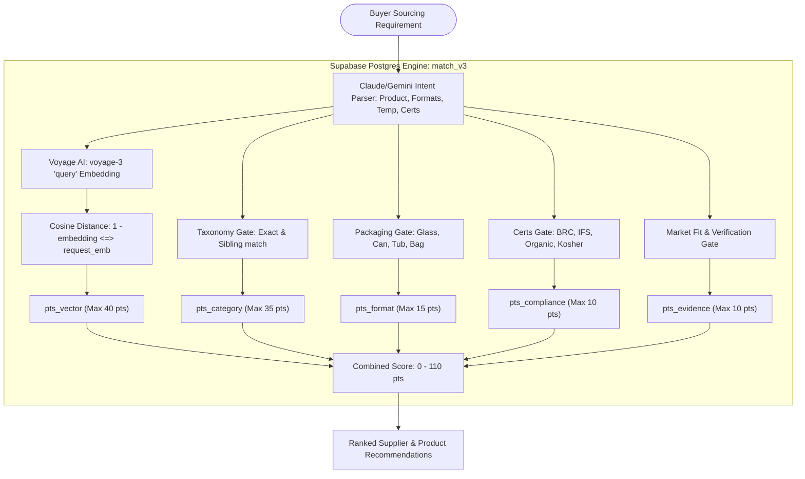
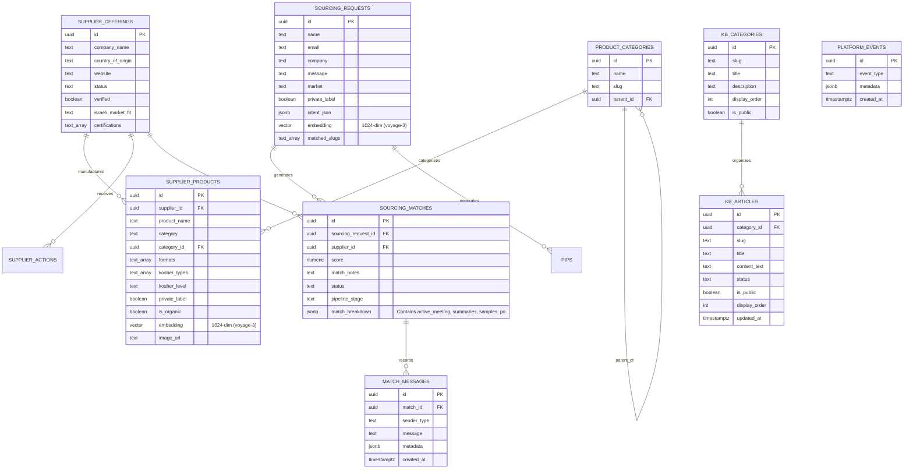

# FoodXchange — System Architecture & Data Model

> **Enterprise Technical Specification & Core Platform Data Models**  
> *Last updated: October 21, 2026*

---

## 1. Cloud Architecture & Service Topology

```mermaid
graph TD
    User([Browser Client: Buyer & Supplier]) -->|HTTPS| Netlify[Netlify Edge CDN]
    AdminUser([Admin Trade Desk]) -->|HTTPS| Netlify
    Netlify -->|App Router SSR & Turbopack| NextJS[Next.js 16 Application]
    
    subgraph Core Data, AI & Communication Platform
        NextJS -->|PostgreSQL & pgvector| Supabase[(Supabase DB)]
        NextJS -->|Object Storage| SStorage[Supabase Storage Buckets]
        NextJS -->|1024-d Dense Embeddings| Voyage[Voyage AI: voyage-3]
        NextJS -->|Meeting Intelligence & PIP Parser| DualAI[Dual AI Engine: Gemini 2.0 / Claude 3.5]
        NextJS -->|Deep Web Product Catalog Spider| Firecrawl[Firecrawl v2 API]
        NextJS -->|Instant Video Conferencing| GoogleMeet[Google Meet & Dual-TZ Calendar Engine]
        NextJS -->|Transactional Emails & Outreach| Resend[Resend Email API]
        NextJS -->|Telemetry & Crash Monitoring| Sentry[Sentry SDK]
    end
```

---

## 2. The Matching Process & AI Architecture (`match_v3`)

The FoodXchange matching engine pairs real-time buyer sourcing inquiries with active European manufacturer catalogs using a hybrid of **semantic vector search** and **hard regulatory trade constraints**.



### Phase 1: Hard Elimination Gates (Pre-Filters)
If a supplier's product fails *any* of the buyer's strict requirements, it is immediately excluded from the candidate pool:

1. **Supplier Approval Status**:
   - `supplier_offerings.status = 'approved'` and `supplier_products.needs_review = false`. Only verified suppliers enter matching.
2. **Private Label Gate**:
   - If the buyer requests private label / own brand, only products where `supplier_products.private_label = true` qualify.
3. **Packaging Format Gate**:
   - If the buyer specifies container requirements (e.g. `cup`, `glass_jar`, `tin_can`, `aseptic_bag`), the supplier product must have an overlapping format array (`sp.formats && req_formats`).
4. **Temperature Regime Gate**:
   - Matches storage conditions: `ambient`, `chilled`, or `frozen`. A chilled/frozen product will never match an ambient shelf-stable request.
5. **Distribution Channel Gate**:
   - Validates whether the supplier can pack for the requested trade channel: `Retail`, `Foodservice` (HoReCa), or `Industry` (bulk ingredients).
6. **Organic Gate**:
   - If the buyer explicitly requests organic, non-organic products (`is_organic = false`) are excluded.

*(Note on Kosher: A lack of kosher mention on a European website is treated as "unknown" rather than "not kosher", because European manufacturers regularly obtain rabbinical batch supervision specifically when an export contract is confirmed).*

---

### Phase 2: The Multi-Factor Scoring Formula (Max 110 Points)

Candidates that pass the hard gates are scored and ranked from 0 to 110 points across 5 parameters:

| Parameter | Max Points | How It Is Evaluated |
| :--- | :---: | :--- |
| **1. Semantic Vector Similarity (`pts_vector`)** | **40 pts** | Uses **Voyage AI’s `voyage-3`** 1024-dimensional embeddings. Computes the cosine similarity between the buyer's descriptive message and the supplier's product specs: <br>$$\text{pts\_vector} = \max\left(0.0, (1.0 - (\text{product\_emb} \Leftrightarrow \text{request\_emb})) \times 40.0\right)$$ |
| **2. Category & Taxonomy Alignment (`pts_category`)** | **35 pts** | Evaluates category hierarchy depth: <br>• **35 pts**: Exact taxonomy node match (e.g., both are `Tomato Products > Paste`)<br>• **30 pts**: Sibling sub-category under the same parent<br>• **25 pts**: Product title keyword match<br>• **18 pts**: High-level category string overlap |
| **3. Packaging Format Compatibility (`pts_format`)** | **15 pts** | • **15 pts**: Supplier offers the exact target format (e.g., 70g cups, 2.5kg cans)<br>• **8 pts**: Buyer specified no strict format preference (neutral)<br>• **0 pts**: Format mismatch |
| **4. Compliance & Food Certifications (`pts_compliance`)** | **10 pts** | Checks overlap of international quality and safety standards requested by Israeli importers:<br>• **10 pts**: Verified match on **BRC**, **IFS**, **ISO 22000**, or **FSSC**<br>• **5 pts**: Buyer had no specific standard requirements |
| **5. Evidence & Israeli Market Fit (`pts_evidence`)** | **10 pts** | Rewards proven reliability and past import history:<br>• **+4 pts**: Supplier is fully verified by FoodXchange<br>• **+3 pts**: Catalog item was manually reviewed by Udi<br>• **+2 pts**: Supplier has past successful export history to Israel (`israeli_market_fit`)<br>• **+1 pt**: Supplier holds active export documentation |

---

## 3. Web Scraping & Ingestion Pipeline (Firecrawl v2)

```mermaid
flowchart LR
    URL[Supplier Website URL] --> Map[Firecrawl.map: Discover URLs]
    Map --> Filter[URL Filter: isProductUrl & isContactUrl]
    Filter --> BatchScrape[Firecrawl.batchScrape: Render JS & Extract Markdown]
    BatchScrape --> LLM[Claude / Gemini LLM: Structured Schema Extraction]
    LLM --> Dedup[Deduplication & Canonical Name Normalization]
    Dedup --> Upload[Supabase Storage: Product Images]
    Upload --> Vectorize[Voyage AI: voyage-3 'document' Embedding]
    Vectorize --> DB[(supplier_products Table)]
```



---

## 4. Deal Intelligence & Execution Engines

FoodXchange features four specialized transaction engines running on top of the relational deal database:

### A. Google Meet & Dual-Timezone Video Calling
- **Instant Meeting Provisioning**: Generates compliant Google Meet room URLs (`https://meet.google.com/fdx-...`) without requiring external Google OAuth tokens.
- **Dual-Timezone Synchronization**: Automatically computes scheduled call times for Israeli buyers (**Asia/Jerusalem - IDT/IST**) and European manufacturers (**Europe/Rome/Paris/Berlin - CEST/CET**).
- **Calendar Dispatch**: Pre-constructs 1-click Google Calendar web invite links with agenda, participants, and meet link preloaded.

### B. AI Call Summarizer (`lib/ai/meetingSummarizer.ts`)
- Dual-provider pipeline leveraging Google Gemini 2.0 Flash and Anthropic Claude 3.5 Sonnet with resilient regex/heuristic fallback.
- Ingests raw meeting transcripts or call notes, extracting:
  - **Executive Summary** (2-3 concise commercial sentences)
  - **Commercial Terms** (CIF price, payment terms, MOQ, lead times)
  - **Sample Commitments** (Courier method, dispatch date, item count)
  - **Quality & Certifications** (Kosher supervision, BRC/IFS audits)
  - **Action Items** (Task, owner `Buyer`/`Supplier`/`FDX Desk`, due date)
  - **Suggested Deal Stage** (e.g. `samples_pending`, `commercial_negotiation`, `po_draft`)

### C. Tasting Samples & Courier Hub (`components/admin/SampleDispatchHub.tsx`)
- Manages physical sample tasting protocols for Israeli food retail category managers.
- Tracks express couriers (DHL, FedEx) with AWB numbers and Israel customs clearance.
- Gathers structured 5-dimension sensory evaluation scores (Taste, Texture, Packaging/Labeling, Shelf-life, Retail Fit).

### D. Bilingual B2B Purchase Order & Production Release Engine
- Generates institutional Hebrew/English Purchase Orders with milestones:
  - 30% advance on PO confirmation
  - 70% against Bill of Lading copy & pre-shipment lab certificate
- Coordinates private-label artwork sign-off, Chief Rabbinate kosher certificate approvals, and container vessel ETAs into Haifa/Ashdod ports.

---

## 5. Complete Supabase Database Schema



---

## 6. Storage Buckets (Supabase Storage)

| Bucket Name | Access | Purpose |
| :--- | :--- | :--- |
| `product-images` | Public | High-resolution photography scraped or uploaded for catalog items |
| `category-images` | Public | Category header photography for the `/en/products` hub |
| `portfolio` | Public | Deal scenario hero banners displayed on `/en/portfolio/[slug]` |
| `blog-images` | Public | Featured covers and inline images for blog articles |
| `supplier-logos` | Public | European manufacturer brand and company logos |
| `buyer-logos` | Public | Israeli retail and importer partner logos |

---

## 7. Security & Authentication Architecture

1. **Admin Master Authentication**:
   - Single-admin architecture protected by client/server rate-limiting (maximum 5 attempts before cooldown lockout).
   - Validation occurs server-side in `app/api/admin/login/route.ts`.
   - Sets an encrypted HMAC-SHA256 cookie (`admin_session`) signed with `ADMIN_SESSION_SECRET`.
   - Admin route middleware checks session validity before rendering protected dashboards (`/admin/*`).
2. **Protected Transactional Endpoints**:
   - All pipeline operational endpoints (`/api/admin/meetings/*`, `/api/admin/pipeline/*`) call `verifySession` to prevent unauthorized invocation.
3. **Database Row Level Security (RLS)**:
   - Client queries run under the public `anon` key with read-only access to published products, public blog posts, and public KB articles (`is_public = true`).
   - All write operations, matching algorithms, and administrative tasks use `supabaseAdmin` with `SUPABASE_SERVICE_ROLE_KEY` in secure server-side routes only.
