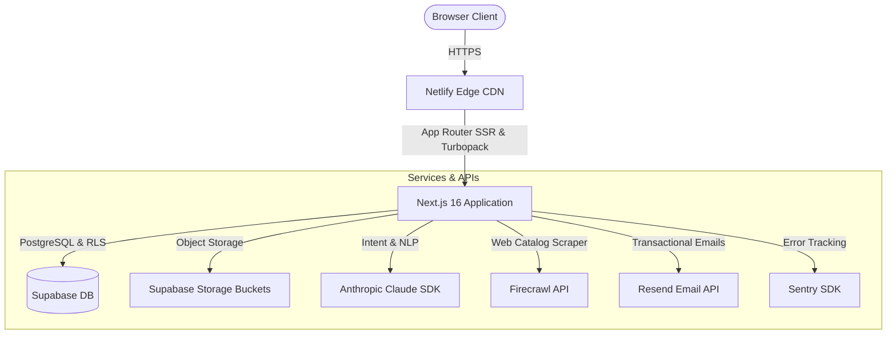

# FoodXchange — System Architecture & Data Model

## 1. Cloud Architecture

---

## 2. Core Database Entities (Supabase PostgreSQL)

### Sourcing & Match Records
- **`sourcing_requests`**: Stores buyer inquiries submitted via contact or sourcing pages. Contains `name`, `email`, `company`, `message`, `market`, `intent_json`, and `matched_slugs`.
- **`sourcing_matches`**: Direct matches established between a buyer request and a verified supplier offering.
- **`supplier_actions`**: Outreach logs and action history (outreach sent, pending, responded, declined).

### Supplier & Product Records
- **`supplier_offerings`**: Verified European suppliers with company metadata, country of origin, and status.
- **`supplier_products`**: Product catalogue items with name, category, kosher certifications, packaging formats, scrape confidence, and media URLs.
- **`category_images`**: Banner images and gradient definitions for the 17 product catalogue categories.

### Content & Media Records
- **`portfolio_items`**: Case study scenarios illustrating past successful deals (EVOO, tomato paste cups, private label pasta, vegetable chips, etc.).
- **`blog_posts`**: Industry insights, market guides, and Israeli import regulation articles (supporting `en` and `he` languages).
- **`admin_notifications`**: In-app notifications surfaced via the admin navigation bell.

---

## 3. Storage Buckets (Supabase Storage)

| Bucket Name | Access | Purpose |
| :--- | :--- | :--- |
| `product-images` | Public | High-resolution product photography scraped or uploaded for catalog items |
| `category-images` | Public | Category header photography for the `/en/products` hub |
| `portfolio` | Public | Deal scenario hero banners displayed on `/en/portfolio/[slug]` |
| `blog-images` | Public | Featured covers and inline images for blog articles |
| `supplier-logos` | Public | European manufacturer brand and company logos |
| `buyer-logos` | Public | Israeli retail and importer partner logos |

---

## 4. Security & Authentication Architecture

1. **Admin Master Authentication**:
   - Single-admin architecture protected by rate-limiting (maximum 5 attempts before cooldown lockout).
   - Validation occurs server-side in `app/api/admin/login/route.ts`.
   - On success, sets an encrypted HMAC-SHA256 cookie (`admin_session`) signed with `ADMIN_SESSION_SECRET`.
   - Admin route middleware checks session validity before rendering protected dashboards (`/admin/*`).
2. **Database Row Level Security (RLS)**:
   - Client queries run under `anon` key with read-only access to published products and public blog posts.
   - All write operations and administrative operations use `supabaseAdmin` with `SUPABASE_SERVICE_ROLE_KEY` in secure server-side routes only.
