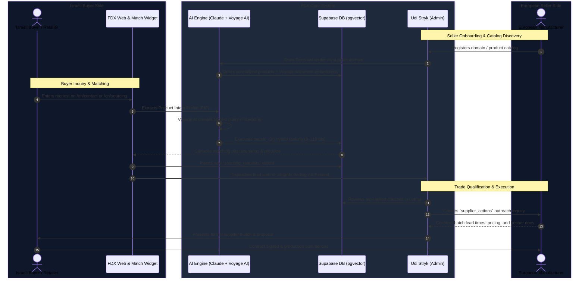

# FoodXchange — Product Story & Business Logic

## 1. What We Build

**FoodXchange (`FDX.TRADING`)** is an international food sourcing platform purpose-built for the Israeli market. It solves two critical challenges in modern food distribution:

1. **For Israeli Retailers, Wholesalers & HoReCa Importers**:
   - Finding reliable, certified European suppliers capable of meeting strict Israeli food standards, kosher certifications (Chief Rabbinate, Badatz, OU, OK), and Hebrew packaging/labeling laws.
   - Sourcing private label (own-brand) products with tailored recipe formulations, retail-ready multipacks, and consistent supply chains.
2. **For European Manufacturers & Exporters**:
   - Gaining compliant, direct access to the high-demand Israeli food market without getting lost in local regulatory, bureaucratic, or language hurdles.

---

## 2. Core Value Propositions

- **Curated European Database**: Over 600+ kosher-certified food products across 17 distinct categories (Olive oil, Italian tomato products, pulses & legumes, snacks, dairy, frozen foods, organic & natural goods).
- **Hybrid Semantic + Constraint Matching Engine**: Natural language sourcing request parsing powered by Claude and Voyage AI (`voyage-3` 1024-d dense vectors). Matches semantic product descriptions while strictly honoring hard trade gates (packaging formats, temperature regimes, and private label availability).
- **Automated Supplier Ingestion**: Automated web catalog scraping via **Firecrawl v2** that parses supplier website inventories directly into structured database rows.
- **Dedicated Founder Guidance**: Every match and sourcing inquiry is vetted and facilitated directly by Udi Stryk (`udi@fdx.trading`), ensuring high trust and smooth deal execution.

---

## 3. End-to-End User Journeys

### Complete Cross-Platform Deal Flow

---

## 4. Key Target Personas

### A. The Israeli Food Buyer
- **Supermarket Chains & Category Managers**: Sourcing private label shelf staples (pasta, canned tomatoes, EVOO, bakery) with cost advantage and Israeli labelling compliance.
- **HoReCa & Foodservice Wholesalers**: Sourcing bulk formats (2.5kg / 5kg cans, 10L aseptic bags, IQF fruits and vegetables).
- **Specialty & Health Importers**: Sourcing organic, vegan, gluten-free, and high-protein snack lines.

### B. The European Manufacturer / Exporter
- Producers in Spain, Italy, France, Greece, Poland, Germany, and Belgium seeking stable, high-margin export markets in Israel without dealing directly with Israeli retail bureaucracy.

---

## 5. How Matching Drives Business Value

By combining **Voyage AI’s `voyage-3` embeddings** for semantic similarity with **deterministic SQL rules** (for packaging, channels, and certifications), FoodXchange avoids the false positives of keyword search and the hallucination risks of pure generative AI. A buyer looking for *"70g tomato cups 22 brix"* is matched directly with Mediterranean tomato processors equipped with cup packaging lines, cutting weeks of manual procurement research down to seconds.
