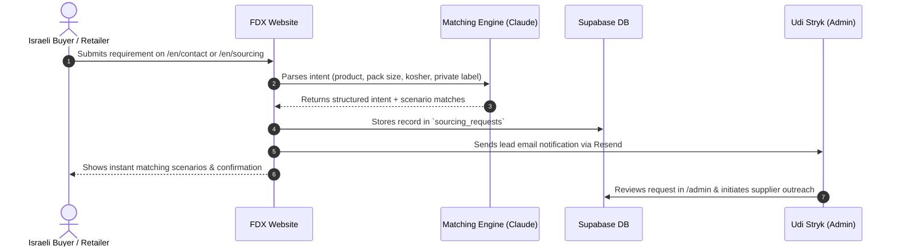
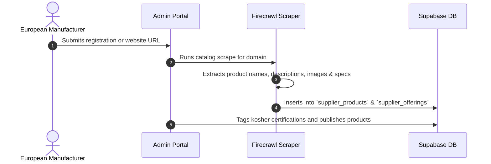

# FoodXchange — Product Story & Business Logic

## 1. What We Build

**FoodXchange (`FDX.TRADING`)** is an international food sourcing platform purpose-built for the Israeli market. It solves two critical challenges in modern food distribution:

1. **For Israeli Retailers, Wholesalers & HoReCa Importers**:
   - Finding reliable, certified European suppliers capable of meeting strict Israeli food standards, kosher certifications (Chief Rabbinate, Badatz, OU, OK), and Hebrew packaging/labeling laws.
   - Sourcing private label (own-brand) products with tailored recipe formulations, retail-ready multipacks, and consistent supply chains.
2. **For European Manufacturers & Exporters**:
   - Gaining compliant, direct access to the high-demand Israeli food market without getting lost in local regulatory, bureaucratic, or language hurdles.

---

## 2. Core Value Propositions

- **Curated European Database**: Over 600+ kosher-certified food products across 17 distinct categories (Olive oil, Italian tomato products, pulses & legumes, snacks, dairy, frozen foods, organic & natural goods).
- **AI-Powered Matching Engine**: Natural language sourcing request parsing powered by Claude 3.5 Sonnet / OpenAI. When a buyer enters an inquiry such as *"tomato paste in 70g cups, private label, 22+ brix"*, our engine extracts product attributes, packaging formats, certifications, and target markets to instantly surface relevant past deals and active suppliers.
- **Automated Supplier Ingestion**: Automated web catalog scraping via **Firecrawl** that parses supplier website inventories directly into structured database rows.
- **Dedicated Founder Guidance**: Every match and sourcing inquiry is vetted and facilitated directly by Udi Stryk (`udi@fdx.trading`), ensuring high trust and smooth deal execution.

---

## 3. End-to-End User Journeys

### A. Sourcing Buyer Journey

### B. Supplier Onboarding & Catalog Extraction

---

## 4. Key Target Markets

1. **Retail Supermarket Chains**: Private label staples (olive oil, canned tomatoes, pasta, baked goods, snacks).
2. **Foodservice & HoReCa**: Bulk foodservice packaging (2.5kg / 5kg canned goods, aseptic bags, industrial cooking bases).
3. **Health Food & Specialty Chains**: Gluten-free, organic, vegan, and Mediterranean specialty goods.
