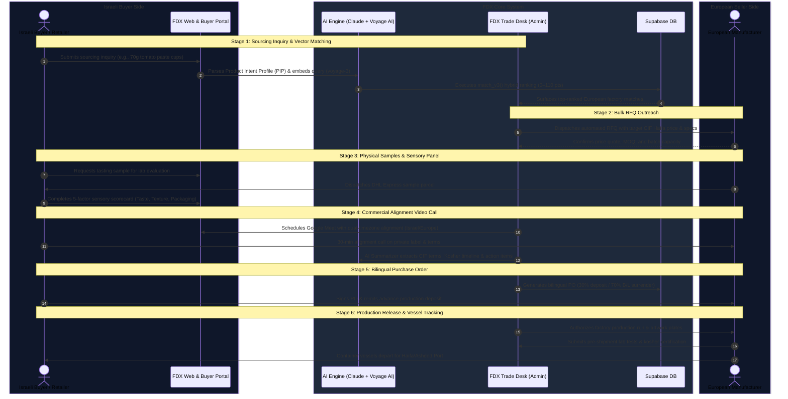

# FoodXchange — Product Story & Deal Lifecycle

> **Strategic Mission, Stakeholder Personas & End-to-End Deal Execution Architecture**  
> *Last updated: October 21, 2026*

---

## 1. What We Build

**FoodXchange (`FDX.TRADING`)** is an international food sourcing platform purpose-built for the Israeli market. It bridges European food manufacturers with Israeli retail supermarket chains, food service distributors (HoReCa), and national importers.

### The Problem in Food Procurement
1. **For Israeli Retailers & Importers**:
   - High local food concentration drives urgency for alternative, direct factory imports.
   - Strict regulatory gates: Chief Rabbinate kosher supervision, Ministry of Health import licenses, and mandatory Hebrew labeling.
   - Sourcing private label (own-brand) products requires months of back-and-forth negotiations over minimum order quantities (MOQs), recipe formulations, and shipping containers.
2. **For European Manufacturers**:
   - Navigating Israeli kosher certification bureaucracy and Hebrew packaging requirements is intimidating without local representation.
   - High friction in validating buyer creditworthiness and structuring compliant payment milestones.

---

## 2. Core Value Propositions

- **Curated European Database**: Over 600+ kosher-certified food products across 17 categories (Olive oil, Italian tomato products, pulses & legumes, snacks, dairy, frozen foods, organic & natural goods).
- **Hybrid Semantic + Constraint Matching Engine**: Natural language sourcing request parsing powered by Claude/Gemini and Voyage AI (`voyage-3` 1024-d dense vectors). Matches semantic product descriptions while strictly honoring hard trade gates (packaging formats, temperature regimes, and private label availability).
- **Automated Supplier Catalog Ingestion**: Web catalog scraping via **Firecrawl v2** that parses manufacturer website inventories directly into structured database records.
- **Full Sourcing-to-Vessel Transaction Desk**: Complete tooling covering bulk RFQ outreach, courier sample dispatch, Google Meet video calls, AI call intelligence, bilingual Purchase Orders, and shipping vessel tracking.

---

## 3. End-to-End Deal Lifecycle (The 6-Stage Sourcing Workflow)

---

## 4. Key Target Personas

### A. The Israeli Food Buyer
- **Supermarket Chains & Category Managers**: Sourcing private label shelf staples (pasta, canned tomatoes, EVOO, bakery) with cost advantage and Israeli labelling compliance.
- **HoReCa & Foodservice Wholesalers**: Sourcing bulk formats (2.5kg / 5kg cans, 10L aseptic bags, IQF fruits and vegetables).
- **Specialty & Health Importers**: Sourcing organic, vegan, gluten-free, and high-protein snack lines.

### B. The European Manufacturer / Exporter
- Producers in Spain, Italy, France, Greece, Poland, Germany, and Belgium seeking stable, high-margin export markets in Israel without dealing directly with Israeli retail bureaucracy.

---

## 5. Detailed Breakdown of the 6 Sourcing Stages

| Stage | Name | Key Objective & Activities | Platform Tooling |
| :---: | :--- | :--- | :--- |
| **1** | **Inquiry & Ingestion** | Buyer specifies product needs, formats, and targets. AI matches verified supplier catalogs. | Contact form, Sourcing Portal, `match_v3` algorithm |
| **2** | **Bulk RFQ Outreach** | Commercial desk dispatches requests for quotation to matched European producers simultaneously. | [`BulkRfqDispatchModal`](file:///c:/Users/UdiFDX/Desktop/WebSites/FDX.TRADING/app/admin/pipeline/BulkRfqDispatchModal.tsx) |
| **3** | **Sample Tasting Hub** | Physical product sent via express courier (DHL/FedEx) to Israeli lab/kitchen for sensory testing. | [`SampleDispatchHub`](file:///c:/Users/UdiFDX/Desktop/WebSites/FDX.TRADING/components/admin/SampleDispatchHub.tsx) & `/api/buyer/request-sample` |
| **4** | **Meet & AI Intelligence** | 30-minute Google Meet alignment call. Dual AI digests meeting notes into executive briefings and agreed terms. | [`MeetingIntelligenceModal`](file:///c:/Users/UdiFDX/Desktop/WebSites/FDX.TRADING/components/admin/meetings/MeetingIntelligenceModal.tsx), `meetingSummarizer.ts` |
| **5** | **B2B Purchase Order** | Formal bilingual purchase contract specifying commercial milestones (30% advance, 70% against B/L). | [`OrderWorkflowModal`](file:///c:/Users/UdiFDX/Desktop/WebSites/FDX.TRADING/components/admin/OrderWorkflowModal.tsx), `/api/admin/pipeline/generate-po` |
| **6** | **Production & Vessel** | Factory initiates dedicated production batch, printing Hebrew packaging plates and booking container freight. | [`ProductionReleaseModal`](file:///c:/Users/UdiFDX/Desktop/WebSites/FDX.TRADING/components/admin/ProductionReleaseModal.tsx) |
