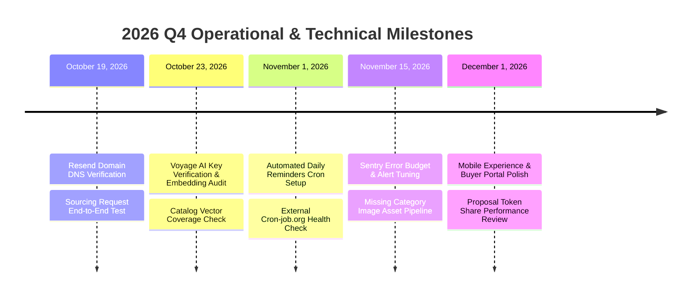

# FoodXchange — Roadmap & Recommended Next Steps

> **Strategic execution roadmap, technical debt resolutions, and scheduled milestones.**  
> *Last updated: October 18, 2026*

---

## 📅 Scheduled Action Milestones

---

## 🎯 Prioritized Next Steps & Checklist

### 1. Resend Email Domain Verification & End-to-End Test
- **Target Date**: **October 19, 2026**
- **Priority**: High (Immediate)
- **Status**: Pending DNS propagation
- **Action Items**:
  - [ ] Log in to [Resend Dashboard](https://resend.com/domains) and verify that `fdx.trading` shows as **Active / Verified** (SPF, DKIM, DMARC).
  - [ ] Submit a test form on [https://fdx.trading/en/contact](https://fdx.trading/en/contact) and confirm delivery to `udi@fdx.trading`.
  - [ ] Test the digital business card contact modal on [https://fdx.trading/business-card/udi](https://fdx.trading/business-card/udi).

---

### 2. Voyage AI Key & Embedding Coverage Audit
- **Target Date**: **October 23, 2026**
- **Priority**: High
- **Context**: The `match_v3()` function relies on 1024-d dense vectors generated by Voyage AI (`voyage-3`). When `VOYAGE_API_KEY` is absent or quota is exceeded, the algorithm defaults to a neutral score (`pts_vector = 20/40`), which reduces ranking accuracy.
- **Action Items**:
  - [ ] Verify `VOYAGE_API_KEY` is present in Netlify production environment variables.
  - [ ] Run `npm run backfill:embeddings` (or `scripts/backfill-embeddings.ts`) to ensure 100% of rows in `supplier_products` have non-null `embedding` values.
  - [ ] Run `scripts/backfill-request-embeddings.ts` on historical `sourcing_requests`.

---

### 3. Automated Cron Reminder Health Check (`/api/cron/send-reminders`)
- **Target Date**: **November 1, 2026**
- **Priority**: Medium
- **Context**: Supplier outreach requests that remain in `pending` status for 3 or 7 days trigger automated follow-up emails via `/api/cron/send-reminders`.
- **Action Items**:
  - [ ] Confirm scheduled cron job on [cron-job.org](https://cron-job.org) is active:
    - **URL**: `https://fdx.trading/api/cron/send-reminders`
    - **Method**: `POST`
    - **Header**: `Authorization: Bearer <CRON_SECRET>`
    - **Schedule**: Daily at 09:00 UTC
  - [ ] Check `platform_events` table for entries logged under `supplier_action_reminder_3d` and `supplier_action_reminder_7d`.

---

### 4. Image Asset Self-Hosting & CDN Optimization
- **Target Date**: **November 15, 2026**
- **Priority**: Medium
- **Context**: Category banners and blog posts were migrated from expired Copilot links to permanent Unsplash photos. To achieve maximum durability and eliminate any external dependency, assets should be mirrored in Supabase Storage.
- **Action Items**:
  - [ ] Mirror all active category banner URLs from Unsplash into the `category-images` Supabase Storage bucket.
  - [ ] Mirror all active blog post covers into the `blog-images` Supabase Storage bucket.
  - [ ] Ensure Next.js Image component quality rules in `next.config.js` match `[75, 85, 90]`.

---

### 5. Buyer Portal & Proposal Share Engine Polish
- **Target Date**: **December 1, 2026**
- **Priority**: Low / Enhancement
- **Context**: Tokenized proposal pages (`/proposals/[token]`) allow prospective Israeli buyers to review customized catalog selections without requiring a login account.
- **Action Items**:
  - [ ] Test WhatsApp direct share buttons on iOS and Android devices.
  - [ ] Review Plausible analytics metrics for buyer conversion rates on proposal pages.
  - [ ] Add PDF export capability for formal retail presentation decks.
