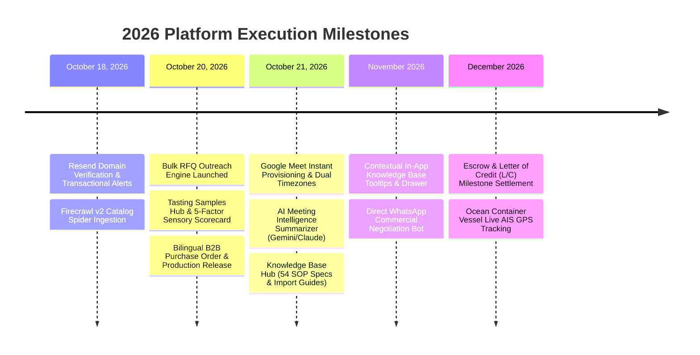

# FoodXchange — Strategic Roadmap & Milestones

> **Strategic Execution Roadmap, Completed Milestones & Planned Projects**  
> *Last updated: October 21, 2026*

---

## 1. Project Milestones & Progress

---

## 2. Completed Milestones (October 2026)

- [x] **Google Meet & Calendar Integration**:
  - Direct Google Meet room provisioning without third-party OAuth.
  - Dual-timezone scheduling (**Israel IDT vs. Europe CEST**).
  - 1-click Google Calendar web invite links with agenda and attendees.
- [x] **AI Call Intelligence Engine (`meetingSummarizer.ts`)**:
  - Structured extraction of CIF Haifa/Ashdod prices, payment terms, MOQ, kosher dates, and action items.
  - Automatic pipeline stage progression and deal history logging.
- [x] **Physical Tasting Samples Hub (`SampleDispatchHub.tsx`)**:
  - Express courier tracking (DHL/FedEx AWB) with Israeli customs clearance status.
  - 5-dimension sensory scorecard (Taste, Texture, Packaging, Shelf life, Retail fit).
- [x] **Bulk RFQ Outreach Engine (`BulkRfqDispatchModal.tsx`)**:
  - 1-click simultaneous RFQ dispatch to multiple European producers.
- [x] **Bilingual B2B Purchase Order & Production Release (`OrderWorkflowModal.tsx`)**:
  - Commercial contracts with 30/70 payment milestone splits, Hebrew plate sign-offs, and vessel ETA tracking.
- [x] **Platform Knowledge Base & SOP Center (`AdminDocsHub.tsx`)**:
  - 54 comprehensive technical specifications, matching algorithms, scraper pipelines, and regulatory playbooks with internal vs. public filtering.

---

## 3. Planned Projects & High-Priority Next Steps

### 1. In-App Contextual KB Tooltips & SOP Helper Drawer
- **Priority**: High (Immediate)
- **Objective**: Bring regulatory and commercial knowledge directly into deal forms without requiring users to navigate away to `/admin/docs`.
- **Scope**:
  - Add interactive tooltips explaining Chief Rabbinate vs. Badatz supervision, Hebrew labeling requirements, and CIF Haifa terms.
  - Add a persistent slide-over `[ 💡 SOP Helper ]` drawer inside the Pipeline, Sample Hub, and Meeting Modals that allows searching all 54 KB specs.

### 2. Automated WhatsApp Trade Facilitation Bot
- **Priority**: High (November 2026)
- **Objective**: Connect European factory export managers and Israeli buyers over WhatsApp Business API for instant quote approvals and delivery alerts.
- **Scope**:
  - Inbound WhatsApp webhook parsing quotes and dispatch confirmations directly into `match_messages`.
  - Instant deal alert broadcasts when sample parcels arrive in Tel Aviv or Haifa.

### 3. Escrow & Milestone Payment Settlement
- **Priority**: Medium (December 2026)
- **Objective**: Mitigate transaction risk for Israeli retailers placing orders with unfamiliar European producers.
- **Scope**:
  - Multi-currency escrow account integration (EUR / USD / ILS).
  - Milestone release upon verified Bill of Lading surrender and independent SGS pre-shipment lab certificate.

### 4. Ocean Container AIS Vessel Live Tracking
- **Priority**: Medium (Q1 2027)
- **Objective**: Real-time GPS location tracking of maritime shipping containers from European ports (Genoa, Valencia, Antwerp, Piraeus) to Haifa and Ashdod.
- **Scope**:
  - Maritime API integration (VesselFinder / MarineTraffic) mapping ocean voyages with arrival countdowns.
